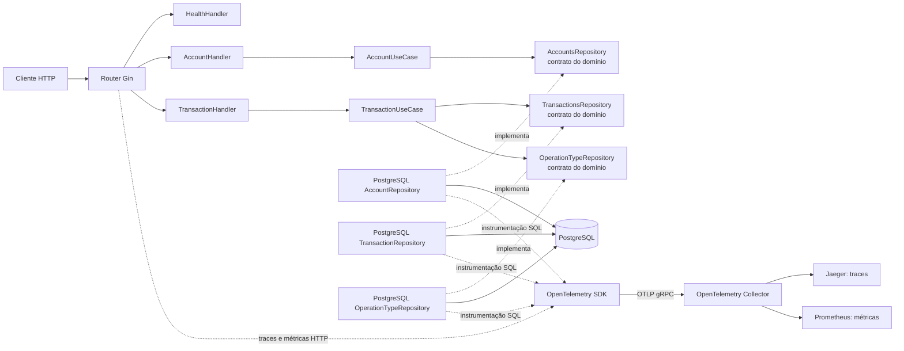

# Arquitetura

A aplicação organiza o fluxo HTTP, as regras de aplicação, o domínio e os adaptadores de infraestrutura em pacotes separados. A composição concreta acontece em [`main.go`](../app/cmd/main.go).

## Responsabilidades dos pacotes

- `internal/adapter/httpapi`: integra Gin com os casos de uso; contém rotas, handlers, DTOs, erros HTTP e métricas de requisição.
- `internal/usecase`: coordena as operações da aplicação e aplica validações e regras de negócio.
- `internal/domain`: contém entidades, erros de domínio e contratos de repositório usados pelos casos de uso.
- `internal/infra/database/postgres`: implementa os contratos de persistência sobre `database/sql` e PostgreSQL.
- `internal/infra/telemetry`: configura providers e exportadores OpenTelemetry.
- `internal/platform/env`: fornece leitura de variáveis de ambiente com valor padrão.

## Fluxo de uma requisição

O diagrama mostra o caminho das operações HTTP e a exportação de telemetria. As dependências concretas são conectadas em [`main.go`](../app/cmd/main.go).

Os testes podem substituir os repositórios PostgreSQL por doubles em memória definidos em [`repositories.go`](../app/internal/testutil/repositories.go).
